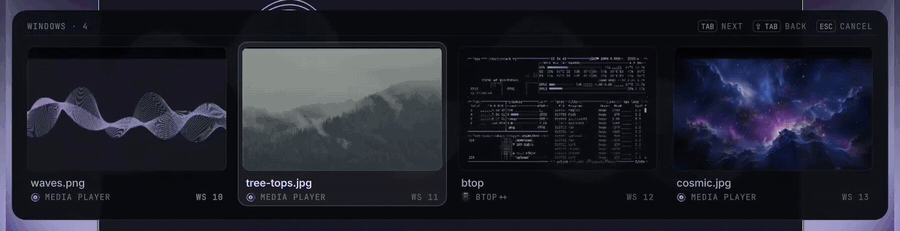
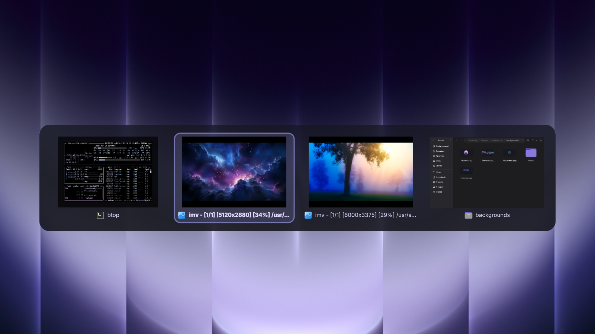

<div align="center">

# Glass Alt+Tab

**Alt+Tab the way it should feel.**
Live window thumbnails on a glass panel, instant on a quick tap.



</div>



## Why this one

- ⚡ **Zero-latency quick switch.** A quick Alt+Tab flips to your previous window
  straight from Hyprland, without ever waking the shell. The panel only appears
  once you keep holding Alt.
- 🖼️ **Live thumbnails** of every window, captured only while the panel is up:
  nothing is recorded in the background.
- 🕐 **Most recently used order**, like Windows and macOS: the window you came from
  first, then this monitor's windows, then the rest.
- ➖ **Minimized windows included.** Pick one and it comes back to the workspace
  you are on, tagged *minimized* in the panel.
- ⌨️ **Every key you expect**: Tab / Shift+Tab, ← →, Enter to pick, Esc to cancel,
  or just click a thumbnail.
- 🧊 **Liquid Glass** behind the panel when the
  [Liquid Glass](https://github.com/fasi96/omarchy-liquid-glass) plugin is
  installed; a translucent plate otherwise.
- 🖥️ Multi-monitor aware: the panel opens on the monitor you are working on and the
  tiles shrink to fit when you have many windows.

## Install

```bash
omarchy plugin add https://github.com/hugorolimf/omarchy-alttab --enable
omarchy-restart-shell
```

That's it. Press Alt+Tab.

## How it hooks in

The switching runs inside Hyprland (`alttab.lua` in the plugin folder), so it is
instant and works even while the shell is busy. The panel is the plugin's QML.

When the plugin loads it writes one small loader,
`~/.local/state/omarchy/toggles/hypr/hugorolimf-alttab.lua`, which Omarchy reads on
every Hyprland reload. It only runs the plugin's `alttab.lua` if that file still
exists, so removing the plugin can never break your config. Your own
`hyprland.lua` and bindings files are not edited.

While the panel is up, the window list (titles included) goes from Hyprland to
the panel through `$XDG_RUNTIME_DIR/glass-alttab/list.json`, in a folder only you
can read (0700). Titles never go in a command line.

It replaces Omarchy's `ALT + TAB` and `ALT + SHIFT + TAB` bindings while loaded.

## Requirements

- Omarchy with the Quattro shell (Quickshell) and Hyprland's Lua config.
- Optional: [Liquid Glass](https://github.com/fasi96/omarchy-liquid-glass) for the glass panel.

No packages are installed and no system file is touched.

## Remove

```bash
omarchy plugin remove io.github.hugorolimf.alttab
rm -f ~/.local/state/omarchy/toggles/hypr/hugorolimf-alttab.lua && hyprctl reload
omarchy-restart-shell
```

Omarchy's own Alt+Tab is back after the reload.

## Pairs well with

[Glass Dock](https://github.com/hugorolimf/omarchy-dock): windows you minimize from
the dock show up here too.

## License

[MIT](LICENSE) © Hugo Rolim Filho
